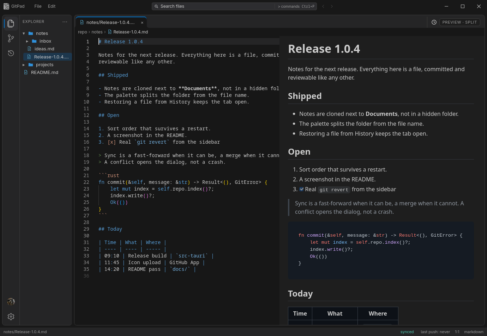

<p align="center">
  
</p>

<h1 align="center">GitPad</h1>

<p align="center"><em>Markdown notes in a Git repository you own.</em></p>

<p align="center">
  <a href="https://github.com/fedeaielli/gitpad/releases/latest"></a>
  <a href="https://github.com/fedeaielli/gitpad/actions/workflows/ci.yml"></a>
  <a href="LICENSE"></a>
  
  <a href="https://tauri.app"></a>
  <a href="https://svelte.dev"></a>
</p>

<p align="center">
  
</p>

GitPad is a local-first desktop editor for Markdown notes and small text files that live in a Git repository you own. It pairs the Monaco editor with a focused GitHub workflow: edit, save automatically, commit locally, and push when you stop typing.

Built with **Tauri 2**, **Rust**, **Svelte 5**, and **Monaco**. Built for Arch Linux and Windows.

> **Status:** the version badge above tracks the latest release. GitPad writes to a real Git repository, so keep backups and use a dedicated notes repository.

---

## First start

1. **Connect GitHub.** Sign in with the OAuth device flow or a personal access token (classic) with the `repo` scope, created at <https://github.com/settings/tokens>. The token is stored in the OS keyring, not in a config file.
2. **Choose a repository.** GitPad uses a private repository named `gitpad_notes` by default (the wizard lets you change the name), creates it if it does not exist, and clones it next to your documents (`~/Documents/gitpad_notes`). The wizard shows the path and lets you pick another folder.
3. **Start writing.** With auto-sync on (the default), files are committed and pushed automatically.

No GitHub? **Use a local folder** from the first screen, or later from *Settings → Sync → Repository folder → Change…*. GitPad opens an existing repository, or the repository above the folder you picked; a plain folder is initialized in place, and a repository without an `origin` remote commits locally and skips sync until you add one.

---

## Why GitPad

GitPad is not Obsidian. It's not Notion. Saving is a git commit.

Most note apps keep your writing in a proprietary database. GitPad keeps it in plain files inside a Git repository:

- **Local-first.** Your notes are ordinary files. Edit them with any editor, inspect them with `git`, read them without GitPad.
- **GitHub-native.** Pull at startup, commit on save, push when you pause. No separate sync service, no account beyond the one you already have.
- **Markdown-friendly.** Split or full-screen preview with GitHub-flavored Markdown and scroll sync.
- **Keyboard-first.** Command palette, file search, tabs, and VS Code/Vim/Emacs keybindings.
- **Small surface area.** One user, one repository, no plugin runtime.

---

## Features

### Editor

- **Monaco editor** with syntax highlighting, tabs, find/replace, and a dark default theme.
- **Slash commands.** Type `/` at the start of a line to insert a heading, emphasis, a code block with its language, a table, a task list, and the rest of GitHub-flavoured Markdown. With text selected the command wraps it.
- **Markdown tables that edit themselves.** `Tab` and `Shift+Tab` move between cells and add a row at the end; inside a cell, `/row`, `/col`, `/delrow` and `/delcol` change the shape. Every change re-renders the table with its columns aligned.
- **Markdown preview.** Toggle off, split, or full screen with `Ctrl+Shift+P`; GitHub-flavored Markdown, syntax highlighting, and scroll sync.
- **Format on demand.** `Ctrl+Shift+I` formats JSON and YAML with Prettier, comments included. Nothing is reformatted on save.
- **Read-only viewers.** Images, PDFs, DOCX and ODT files open in their own tab: PDFs render page by page as you scroll, office documents become a clean HTML preview.
- **Warm Graphite theme.** A curated dark, light, and high-contrast palette built on one type scale and one gutter width. The UI font is Hanken Grotesk (bundled), falling back to system UI.
- **File icons from vscode-icons.** The tree shows the real vscode-icons artwork for 29 common file types and folders, with generic fallbacks.

### Git and sync

- **Automatic save and sync.** Edits are written after a short debounce (2 s by default), committed locally, and pushed after you stop typing (30 s by default), on window blur, or on close. `Ctrl+S` does both immediately.
- **GitHub integration.** Sign in with GitHub (OAuth device flow) or a personal access token, create a private `gitpad_notes` repository by default or clone an existing one, pull at startup, and push from the Git panel.
- **Conflict resolution.** When a pull conflicts, GitPad opens a diff dialog with local and remote versions. Accept one side, edit manually, then confirm the merge.
- **Commit history.** Browse the repository log, inspect changed files, restore a file from a commit, or revert a commit. With a file open, the list narrows to the commits that touch it.

### Navigation

- **File tree.** Create, rename, delete, import files or folders, and jump between notes. Folder creation keeps a `.gitkeep`. Folders are sorted by name, date, or type, and the choice is remembered.
- **Command palette.** `Ctrl+P` for files, `>` for commands, and `>search` for full-text search; press it again to close.
- **History and File Timeline.** Hash and date on one line, message on the next, with restore and revert one click away.
- **Every splitter is draggable.** Sidebar, preview, Git panel and timeline resize from their own handles.

### Settings and logs

- **Settings.** Theme, font size, auto-sync, debounce/idle timing, keybindings, and file-extension-to-language mappings. Everything is saved to `config.json` and restored on the next start.
- **Session logs.** *Settings → Logs* shows the current session and the previous ones, filterable by severity, category (editor, git, app), and free text.
  Tracked: repository open/move/import/clone, every commit, pull and push outcome, conflicts, folder and file changes, sign-in and sign-out (never the token), GitHub calls by status code, startup, shutdown, and every message the UI shows as a toast or a crash. File contents and request bodies are never logged.
- **Credentials in the OS keyring.** The GitHub token is never written to `config.json`; when the keyring is unavailable it goes to a protected file under the app data dir (mode 0600 on Linux, the user profile's ACL on Windows).

---

## Install

### Windows

Download `GitPad_<version>_x64-setup.exe` from the [releases page](https://github.com/fedeaielli/gitpad/releases) and run it. It installs for the current user, so Windows shows no administrator prompt.

Windows 10 (1803 or newer) and Windows 11 on x64 are supported; WebView2 is installed on first run when it is missing. The installer is not code-signed, so SmartScreen may say "Windows protected your PC": choose **More info → Run anyway**. The GitHub token lives in Windows Credential Manager.

### Arch Linux

A `PKGBUILD` lives in `packaging/`. It is **not published on the AUR yet**.

```sh
git clone https://github.com/fedeaielli/gitpad.git
cd gitpad/packaging
makepkg -si
```

### AppImage

Download the latest AppImage from the [releases page](https://github.com/fedeaielli/gitpad/releases), then:

```sh
chmod +x GitPad_*.AppImage
./GitPad_*.AppImage
```

Nothing to install and no root: GTK and WebKitGTK travel inside the bundle. It needs a glibc at least as new as the one it was built against — the release AppImage is built on Arch, and Arch is the only target it is tested on. The desktop's Secret Service (`gnome-keyring`, or KWallet on KDE) is preferred for the token; without it the token goes to a protected file.

### From source

Requirements:

- Rust **1.90+**. Install it from [rustup](https://rustup.rs): distribution packages are often older.
- Node.js **20+** (current LTS recommended)
- Build dependencies: GTK 3, WebKitGTK 4.1, libsoup 3, OpenSSL, libsecret (the keyring), libgit2

On Arch:

```sh
sudo pacman -S --needed base-devel webkit2gtk-4.1 gtk3 libsoup3 openssl libsecret libgit2 nodejs npm rust
```

Then, in a clone of the repository:

```sh
npm ci
npm run tauri dev                    # development
npm run tauri build                  # release build, AppImage
npm run tauri build -- --no-bundle   # just the binary: src-tauri/target/release/gitpad
```

The AppImage is written to `src-tauri/target/release/bundle/`. Build it on the oldest machine you want it to run on: the bundle carries that machine's libraries, and glibc cannot be newer than the one it was compiled against. `--no-bundle` sidesteps the question, since the binary links the libraries you already installed.

Other distributions are not supported: the dependencies above have different package names and versions there, and a build that works is your own. If you want support for yours, open an issue before writing the patch.

On Windows, install the MSVC Rust toolchain and the **Desktop development with C++** workload of the Visual Studio Build Tools, then run the same `npm ci` and `npm run tauri build` commands. The installer lands in `src-tauri/target/release/bundle/nsis/`.

---

## How sync works

With auto-sync enabled (the default):

1. You type. After the save debounce, GitPad writes the file atomically and creates a local commit:
   `gitpad: update <filename> <ISO-8601 timestamp>`
2. After the push idle timeout, on window blur, or on close, GitPad pushes the local commits.
3. At startup GitPad pulls the configured repository. If the working tree has conflicts, it opens the conflict dialog instead of overwriting anything.
4. The Git panel also exposes manual **Sync**, **Pull**, **Push**, and **Commit** actions.
5. Offline, the save is still a local commit. The push reports *Offline — changes are saved locally* and the queued commits go out on the next successful sync. A window without an account signed in skips the push entirely and says the file was saved locally.

GitPad never force-pushes and never rebases. Pulls fast-forward when possible, otherwise they create a merge commit. A repository without an `origin` remote skips fetch and push: commits stay on this machine.

---

## Shortcuts

| Action | Shortcut |
|---|---|
| Save every open file now, then push | `Ctrl+S` |
| New file (type `name.ext`) | `Ctrl+N` |
| Import a file or folder (into the repo root) | `Ctrl+O` |
| Command palette (toggle) | `Ctrl+P` |
| Cycle Markdown preview: off → split → full | `Ctrl+Shift+P` |
| Format the open JSON or YAML document | `Ctrl+Shift+I` |
| Find in files | `Ctrl+Shift+F` |
| Find / find and replace in the open file | `Ctrl+F` / `Ctrl+R` |
| Go to line (editor focused) | `Ctrl+G` |
| Toggle line / block comment | `Ctrl+/` / `Shift+Alt+A` |
| File history | `Ctrl+H` |
| Close tab | `Ctrl+W` |
| Keyboard shortcut list | `Ctrl+K` |
| Move selection in the palette | `Up` / `Down` |
| Open, run, or submit | `Enter` |
| Close the palette or a dialog | `Esc` |

Saving is automatic (2 s debounce) and pushing is automatic too (30 s idle, window blur, or close). `Ctrl+S` only skips those two waits; it does not disable autosave.

Mouse and UI actions:

- Right-click a file in the tree to create, rename, or delete.
- Middle-click a tab to close it.
- Click the conflict badge in the status bar to reopen the merge dialog.
- Open settings from the gear in the status bar.

See [SHORTCUTS.md](SHORTCUTS.md) for the full list.

---

## Where things are stored

On Linux, under `~/.local/share/com.gitpad.app/`; on Windows, under `%APPDATA%\com.gitpad.app\`:

| Path | Contents |
|---|---|
| `config.json` | Theme, font, sync and sorting settings, extension mappings |
| `logs/gitpad.log` | Session log, rotated at 5 MB with the last 5 files kept (~25 MB) |
| `auth.token` | GitHub token, only when the OS keyring is unavailable (mode 0600 on Linux) |
| OS keyring | GitHub token, preferred: Secret Service on Linux, Credential Manager on Windows |

The notes repository lives where the wizard put it: `~/Documents/gitpad_notes` by default, or any folder you pick. `repos/gitpad_notes/` above is only used by clones made before 1.0.4.

Deleting `config.json` resets settings but leaves the notes repository untouched.

---

## Limits worth knowing

- **One repository at a time.** *Settings → Sync → Repository folder → Change…* switches to another folder, but there is no "close repository" state. Picking a subfolder opens the repository above it, and importing into the active repository is refused, so GitPad never nests one clone inside another.
- **A repository nested in the notes folder is ignored.** Files of a clone that lives inside the notes repository (for example `~/Documents/gitpad_notes` inside `~/Documents`) are not committed and not synced; move it out or make it a submodule if you want it versioned.
- **One window.** Launching GitPad again raises the window already open instead of starting a second copy, which would autosave, commit and push twice.
- **Only `origin` is recognized.** A repository whose remote has another name is treated as local-only.
- **External edits reload open tabs.** GitPad watches the repository with a filesystem watch. A file changed by another editor, the `git` CLI, or a script reloads its tab when the tab has no unsaved edits; a tab with unsaved edits is marked stale and its autosave pauses, so nothing is overwritten. Deleting a file elsewhere closes its tab with a "deleted externally" toast.
- **The watcher skips `.git` and `.gitignore`d paths.** GitPad's own saves and commits never trigger a reload, and build output stays quiet. If the watch cannot start (watch limit, a folder moved under it), GitPad falls back to refreshing the tree and the Git status when the window regains focus.
- **Remote images are blocked in preview.** The content security policy allows local/data images and GitHub avatars, not arbitrary remote images.
- **Imports block autosave.** A long import holds the worktree lock for the whole copy, so autosaves queue behind it and run when the copy finishes.
- **Crash safety.** Closing the window, or `SIGTERM` on Linux, commits and pushes files already written before exit. A crash, `SIGKILL`, or a Windows logoff cannot be caught; the last edits remain local until the next start.
- **Logs stop at 5 files.** Rotation keeps five 5 MB files, so the oldest sessions are dropped once the folder reaches roughly 25 MB.
- **Without a keyring, the token lives in a protected file.** If the OS keyring is missing or locked on Linux, GitPad keeps the token in `auth.token` (mode 0600) under the app data dir, warns at startup, and still signs in after a restart. The file is removed on logout, or at the next sign-in when the keyring accepts the token.
- **The AppImage is as new as its build host.** It is built on Arch and tested on Arch; elsewhere it may fail with a missing glibc or WebKit library. Build from source for your own machine.
- **Linux and Windows x64.** macOS is not supported, and neither is Windows on ARM.
- **Not a full Git client.** There is no branch UI, terminal, plugin system, or multi-user collaboration.

---

## Privacy

- GitPad talks to GitHub only for the repository operations you configure.
- The token lives in the OS keyring, or in a mode-0600 file under the app data dir when the keyring is unavailable; it is never written to `config.json`.
- There is no analytics, telemetry, or third-party crash reporting.
- Logging out deletes the token from the keyring and removes `auth.token` if it exists. It is not revoked on GitHub: the device flow uses a public client, and GitHub only accepts revocation signed with a client secret.
- Monaco and all front-end assets are bundled locally; the app does not load them from a CDN.

---

## Development

```sh
npm ci
npm run tauri dev
```

Useful checks:

```sh
npm test                                  # Vitest
npm run check                             # svelte-check + TypeScript
cargo test --manifest-path src-tauri/Cargo.toml
npm run build                             # front-end production build
npm run tauri build                       # AppImage on Linux, NSIS installer on Windows
```

Two things are not covered by the unit tests and are checked by hand before a
release: the unsaved-changes dialog on close, and the PDF/office viewers inside
WebKitGTK. Both are described in [docs/TESTING.md](docs/TESTING.md).

---

## Project layout

```text
src/                    Svelte 5 front end
  lib/components/       editor, sidebar, Git panel, dialogs, settings
  lib/stores/           tabs, Git state, auth, UI state
  lib/utils/            language map, debounce, save guard, pull reload
src-tauri/src/          Rust back end
  fs.rs                 file reads/writes, atomic saves, imports
  git.rs                status, pull/push, history, conflicts
  github.rs             GitHub API
  auth.rs               OS keyring, protected-file fallback
  search.rs             repository search
  watcher.rs            debounced filesystem watch on the repository
packaging/              PKGBUILD and .SRCINFO for Arch
```

---

## Contributing

**What helps.** Bug reports with the session log attached (*Settings → Logs*, filter by severity, copy), and testing on Arch under both Wayland and X11, or on Windows 10/11.

**What to avoid.** Large pull requests without an issue first. This is a personal project with one user's data in it, so design changes are discussed before they are written.

**Where the code lives.** [Project layout](#project-layout) maps every file; the Rust side is `src-tauri/src`, the UI is `src/lib`, and the tests sit next to what they test.

Before sending a PR, run:

```sh
npm test
npm run check
cargo test --manifest-path src-tauri/Cargo.toml
```

---

## Changelog

Every release is documented in [CHANGELOG.md](CHANGELOG.md); the [releases
page](https://github.com/fedeaielli/gitpad/releases) carries the same notes with
the binaries attached.

## License

GitPad is released under the [GNU General Public License v3.0](LICENSE).

Copyright © 2026 Fede.
